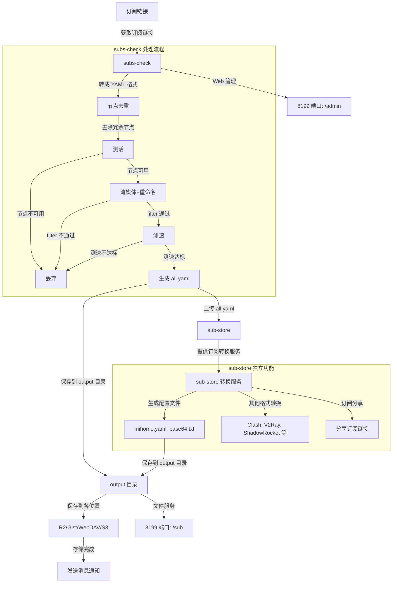

<h1 align="center">🚀 订阅检测转换工具 (Enhanced with Native Telegram Proxy)</h1>

<p align="center">
	<a href="https://github.com/xbajiu/subs-check/releases"></a>
	<a href="https://github.com/xbajiu/subs-check/pkgs/container/subs-check"></a>
	<a href="https://github.com/xbajiu/subs-check/issues"></a>
	<a href="https://github.com/xbajiu/subs-check/blob/master/LICENSE"></a>
</p>

---

> **💡 本项目基于 [beck-8/subs-check](https://github.com/beck-8/subs-check) 进行增强与定制维护：**  
> 1. **✈️ 原生 Telegram 推送**：无需单独部署复杂的 Apprise，原生直接通过 Telegram Bot 发送节点测试结果；
> 2. **🌐 支持 TG 推送自定义反代域名**（`proxy-tg`）：在受限网络环境或大陆机器可配置自建或公共反代域名直连推送；
> 3. **🛡️ 智能自动同步与冲突自愈**：通过 GitHub Actions 自动跟进上游 `beck-8/subs-check` 最新功能，并自动化自愈保护自定义功能不丢失；
> 4. **🐳 自动构建 GHCR 多架构 Docker 镜像**：提供 `ghcr.io/xbajiu/subs-check:latest` 开箱即用。

> **⚠️ 注意：** 功能更新频繁，请查看最新的[配置文件](https://github.com/xbajiu/subs-check/blob/master/config/config.example.yaml)以获取最新功能。

## 📸 预览

  
  

| | |
|---|---|
|  |   |

## ✨ 功能特性

- **✈️ 原生 Telegram 推送（支持自定义反代域名，免部署 Apprise）**
- **🔗 订阅合并**
- **🔍 节点可用性检测**
- **🗑️ 节点去重**
- **⏱️ 节点测速**
- **🎬 流媒体平台解锁检测**
- **✏️ 节点重命名**
- **🔄 任意格式订阅转换**
- **🔔 支持100+通知渠道（兼容原有 Apprise）**
- **🌐 内置 Sub-Store**
- **🖥️ WEB 控制面板**
- **⏰ 支持 Crontab 表达式**
- **🖥️ 多平台支持**

## 🛠️ 部署与使用 
> 首次运行会在当前目录生成默认配置文件。

### 🐳 Docker 运行（推荐）

> **⚠️ 注意：**  
> - 限制内存请使用 `--memory="500m"`。  
> - 可通过环境变量 `API_KEY` 设置 Web 控制面板的 API Key。

```bash
# 基础运行
docker run -d \
  --name subs-check \
  -p 8299:8299 \
  -p 8199:8199 \
  -v ./config:/app/config \
  -v ./output:/app/output \
  --restart always \
  ghcr.io/xbajiu/subs-check:latest

# 使用代理运行
docker run -d \
  --name subs-check \
  -p 8299:8299 \
  -p 8199:8199 \
  -e HTTP_PROXY=http://192.168.1.1:7890 \
  -e HTTPS_PROXY=http://192.168.1.1:7890 \
  -v ./config:/app/config \
  -v ./output:/app/output \
  --restart always \
  ghcr.io/xbajiu/subs-check:latest
```

### 📜 Docker-Compose

```yaml
version: "3"
services:
  subs-check:
    image: ghcr.io/xbajiu/subs-check:latest
    container_name: subs-check
    volumes:
      - ./config:/app/config
      - ./output:/app/output
    ports:
      - "8299:8299"
      - "8199:8199"
    environment:
      - TZ=Asia/Shanghai
      # - HTTP_PROXY=http://192.168.1.1:7890
      # - HTTPS_PROXY=http://192.168.1.1:7890
      # - API_KEY=subs-check
    restart: always
    network_mode: bridge
```

### 🖥️ 源码运行

```bash
go run . -f ./config/config.yaml
```

## 🔔 通知渠道配置（可选）
<details>
  <summary>展开查看</summary>

### ✈️ Telegram 原生直接推送（推荐，无需部署 Apprise，支持自定义反代域名）

> **💡 说明：** 类似 CloudFastDDNS 的 Telegram 推送方式，直接填写 Bot Token 与 Chat ID 即可使用；在网络受限环境可配置反向代理域名。

```yaml
# telegram 机器人 Token (通过 @BotFather 获取)
telegram-bot-token: "123456789:ABCdefGhIJKlmNoPQRstuVWXyz"
# 接收通知的 Chat ID (个人 ID 或频道/群组 ID，例如 987654321 或 -100123456789)
telegram-chat-id: "987654321"
# TG 推送代理域名 (留空默认使用 https://api.telegram.org；国内环境可配置自建或公共反代)
proxy-tg: "https://tgproxy.example.com"
```

### 📦 Apprise 多渠道通知（支持 100+ 渠道）

> 通过 [Apprise](https://github.com/caronc/apprise) 发送通知。

```yaml
# 填写搭建的apprise API server 地址
# https://notify.xxxx.us.kg/notify
apprise-api-server: "https://diydomain.com/notify"
# 填写通知目标
recipient-url: 
  # telegram格式：tgram://{bot_token}/{chat_id}
  # - tgram://xxxxxx/-1002149239223
  # 钉钉格式：dingtalk://{Secret}@{ApiKey}
  # - dingtalk://xxxxxx@xxxxxxx
# 自定义通知标题
notify-title: "🔔 节点状态更新"
```
</details>

## 💾 保存方法配置

> **⚠️ 注意：** 选择保存方法时，请更改 `save-method` 配置。

- **本地保存**：保存到 `./output` 文件夹。
- **R2**：保存到 Cloudflare R2 [配置方法](./doc/r2.md)。
- **Gist**：保存到 GitHub Gist [配置方法](./doc/gist.md)。
- **WebDAV**：保存到 WebDAV 服务器 [配置方法](./doc/webdav.md)。
- **S3**：保存到 S3 对象存储。

## 📲 订阅使用方法

> **💡 提示：** 内置 Sub-Store，可生成多种订阅格式；高级玩家可DIY很多功能

**🚀 通用订阅**
```bash
# 通用订阅
http://127.0.0.1:8299/download/sub

# URI 订阅
http://127.0.0.1:8299/download/sub?target=URI

# Mihomo/ClashMeta
http://127.0.0.1:8299/download/sub?target=ClashMeta

# Clash
http://127.0.0.1:8299/download/sub?target=Clash

# V2Ray
http://127.0.0.1:8299/download/sub?target=V2Ray

# ShadowRocket
http://127.0.0.1:8299/download/sub?target=ShadowRocket

# Quantumult
http://127.0.0.1:8299/download/sub?target=QX

# Sing-Box
http://127.0.0.1:8299/download/sub?target=sing-box

# Surge
http://127.0.0.1:8299/download/sub?target=Surge

# Surfboard
http://127.0.0.1:8299/download/sub?target=Surfboard
```

**🚀 Mihomo/Clash 订阅（带规则）：**
> 默认使用 `https://raw.githubusercontent.com/beck-8/override-hub/refs/heads/main/yaml/ACL4SSR_Online_Full.yaml` 覆写  
可在配置中更改 `mihomo-overwrite-url`。
```bash
http://127.0.0.1:8299/api/file/mihomo
```

## 🌐 内置端口说明
> subs-check本身会在测试完后保存三个文件到output目录中；output目录中的所有文件会被8199端口提供文件服务

| 服务地址                        | 格式说明                | 来源说明|
|-------------------------------|-------------------|----|
| `http://127.0.0.1:8199/sub/all.yaml`   | Clash 格式节点 |由subs-check直接生成|
| `http://127.0.0.1:8199/sub/mihomo.yaml`| 带分流规则的 Mihomo/Clash 订阅 |从上方sub-store转换下载后提供|
| `http://127.0.0.1:8199/sub/base64.txt` | Base64 格式订阅 |从上方sub-store转换下载后提供|
| `http://127.0.0.1:8199/export/surge` 等 | Surge / Loon / Quantumult X / Shadowrocket / Stash / Surfboard / Egern / Clash.Meta / Clash / sing-box / URI 订阅 |在 Web 控制面板生成后提供|

## 🗺️ 架构图
<details>
  <summary>展开查看</summary>



</details>

## 🙏 鸣谢
原项目作者 [beck-8](https://github.com/beck-8/subs-check)、[cmliu](https://github.com/cmliu)、[Sub-Store](https://github.com/sub-store-org/Sub-Store)、[bestruirui](https://github.com/bestruirui/BestSub)、[1password](https://1password.com/)、[ipinfo.io](https://ipinfo.io/)

## ⚖️ 免责声明

本工具仅供学习和研究使用，使用者应自行承担风险并遵守相关法律法规。
